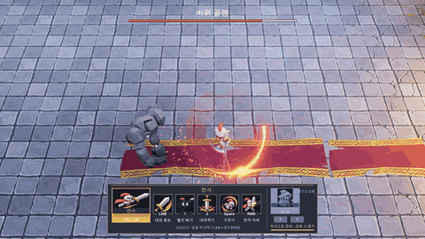
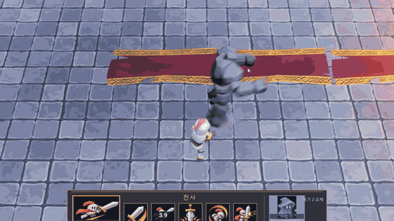
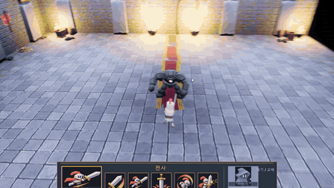
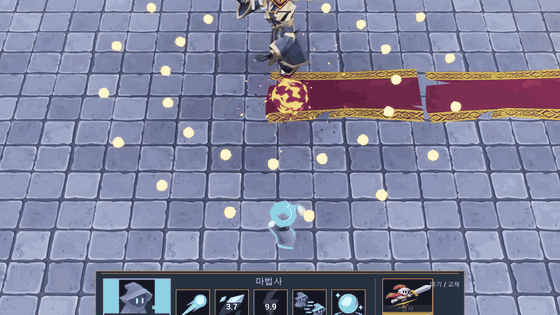
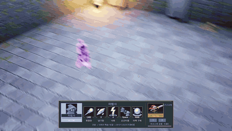
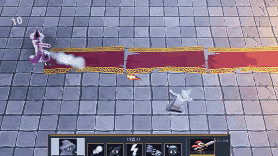

# TwinSwift — 태그 액션 보스 러시

> 전사와 마법사를 실시간으로 바꿔 가며(태그) 싸우는 3D 액션 보스 러시.
> 보스 셋이 각자 다른 방식으로 "교체를 잘해야 이기게" 만들어져 있다.

**▶ 플레이 영상 2분: 링크 추가 예정**

| 항목 | 내용 |
|---|---|
| 엔진 | Unreal Engine 5.7 · C++ · Gameplay Ability System (UI 배치는 WBP) |
| 장르 | 3D 쿼터뷰 액션 · 보스 러시 (보스 3 + 강화 카드) |
| 개발 | 1인 · 2026.10 – 2026.11 |
| 규모 | C++ 약 2만 줄(140 파일) · 에디터 Python 자동화 스크립트 82개 |
| 원칙 | 1차 프로젝트([S_Project](https://github.com/hauras/S_Project))를 측정해 한계를 찾고 → 구조부터 다시 설계 → 숫자로 확인 |

---

## 게임 흐름

```
[메인 메뉴] 시작 · 조작법 · 설정(화면 모드 · 해상도 · 품질 · 프레임 제한)
      ↓
[보스 1] 바위 골렘     표식 시너지 · 2페이즈 갑옷 깨기
      ↓  강화 카드 3장 중 1장 (게임 정지 · 잃은 체력 50% 회복)
[보스 2] 탄막 지휘자   색 탄막 · 박자 · 충격파 반격
      ↓  강화 카드
[보스 3] 거울 기사     내 기술을 3초 뒤 돌려줌 · 2페이즈 거울 반전
      ↓
[클리어] 처치 시간 · R 다시 시작
```

### 조작
| | 전사 (근접, 대검) | 마법사 (원거리, 커서 겨냥) |
|---|---|---|
| 좌클릭 | 대검 2타 콤보 | 화염탄 연사 |
| 스킬 | `1` 돌진 베기 · `2` 내려찍기 → [균열] | `3` 냉기탄 → [빙결] · `4` 낙뢰 (균열 연쇄 폭발) |
| 우클릭 | 반격 자세 | 마력 구체 (설치 → 재입력 폭발) |
| Space · Tab | 구르기 · 교체 | 점멸 · 교체 |

---

## 핵심 시스템

### 1. 태그 교체 — 액터 하나에 몸 둘, ASC 둘


- **스킬 입력 = 교체:** 상대 캐릭터의 스킬 키를 누르면 바꾸면서 바로 시전함. 그 스킬이 쿨다운이면 교체도 하지 않음 (교체 전에 상대 ASC에서 발동 가능 여부 확인)
- **상주형:** `APlayerCharacter` 하나에 전사·마법사 몸. 교체하면 보이는 몸과 "지금 ASC"만 바뀜 → Possess·`InitAbilityActorInfo`를 다시 부르지 않음
- `ASPlayerState`가 ASC 2개 + AttributeSet 2개를 가짐 → 체력·쿨다운·상태 태그가 캐릭터마다 따로. 대기 중인 캐릭터는 천천히 회복
- ASC마다 `AbilityActorInfo->SkeletalMeshComponent`를 그 캐릭터 몸으로 고정 (안 하면 숨긴 몸에서 몽타주가 재생됨)
- **완벽 회피:** 교체·회피 직후 0.25초 안에 맞으면 피해 없음 + 세상 0.3배 슬로
- 코드: [`PlayerCharacter.cpp`](Source/TwinSwift/Private/Character/PlayerCharacter.cpp) · [`SPlayerState.cpp`](Source/TwinSwift/Private/State/SPlayerState.cpp) · [`SPlayerController.cpp`](Source/TwinSwift/Private/Controller/SPlayerController.cpp)

### 2. 양방향 표식과 보스 1 · 바위 골렘


- **표식:** 한 캐릭터가 걸고 다른 캐릭터가 터뜨림. 확률이 아니라 정해진 스킬
  - 마법사 냉기탄 [빙결] → 전사가 치면 **산산조각** (3배 + 경직)
  - 전사 내려찍기 [균열] → 마법사 낙뢰가 **연쇄 폭발**: 반경 안 [균열]로 번지는 **BFS** (방문 표시 `TSet`, 단계별 시간차, 최대 5단계)
- **패턴 선택:** 거리·쿨다운으로 거른 뒤 **유틸리티 점수**(가중치 × 거리 × 최근 사용 감점) → 최고점 70% 이상만 **셔플 백**(피셔-예이츠, 직전 패턴이 맨 앞이면 바꿈)
- **2페이즈 "대지의 분노"** (체력 40%): 바위 갑옷(받는 피해 ×0.2) → 약 7초 충전 → 경기장 전체 강타. **표식 폭발 1번**으로만 깨짐 → 깨면 4초 큰 경직(받는 피해 ×1.5)
- 충전 동작은 새 애니 없이 내려치기 몽타주를 팔을 든 자세까지 느리게 재생. 공격 시계가 몽타주 위치라 재생 속도를 바꿔도 예고·판정이 모션과 맞음
- 코드: [`SGA_ThunderStrike.cpp`](Source/TwinSwift/Private/Ability/GA/SGA_ThunderStrike.cpp) · [`SBossPatternComponent.cpp`](Source/TwinSwift/Private/AI/SBossPatternComponent.cpp) · [`BossCharacter.cpp`](Source/TwinSwift/Private/Character/BossCharacter.cpp)

### 3. 입력 버퍼와 행동 허용 창


- 공격을 **준비 / 타격 / 후딜**로 나눔: 타격 전에는 못 끊고, 타격 뒤에는 허용된 행동으로 끊음
- 끊을 수 있는 구간은 몽타주 노티파이(`ANS_ActionWindow` → `Window.Combo/Dodge/Swap/Skill` 태그). 공격마다 코드 없음
- `USInputBufferComponent`: 지금 안 되는 입력을 1칸에 0.3초 보관 → 창이 열리면 실행. 경직·사망·교체 때 버림
- 결과: 전사 1타 → 2타 연결 **1.07초 → 약 0.61초**
- **반격 자세(우클릭):** 0.8초 안에 맞으면 피해를 버리고 반격. 막는 순간 이펙트 + 0.12초 멈춤 + 흔들림, 칼이 지나가는 노티파이 순간 피해·보스 큰 경직. 막힘 판정은 `IsHitBlocked` 한 곳
- 코드: [`SInputBufferComponent.cpp`](Source/TwinSwift/Private/Input/SInputBufferComponent.cpp) · [`ANS_ActionWindow.cpp`](Source/TwinSwift/Private/AnimNotify/ANS_ActionWindow.cpp) · [`SGA_Parry.cpp`](Source/TwinSwift/Private/Ability/GA/SGA_Parry.cpp)

### 4. 보스 2 · 탄막 지휘자 — 탄 1발 = 배열 한 칸


- **색 탄:** 주황은 전사, 파랑은 마법사만 막음 → 한 색 벽이 오면 그 색 캐릭터로 교체해야 통과
- **탄막 매니저:** 탄은 액터가 아니라 `UPROPERTY` 없는 구조체 배열 → GC가 훑지 않음. Tick 한 번에 이동 → 플레이어 몸(1~2개)과 이동 선분 거리 비교 → 맨 끝과 바꿔 지우기(O(1)) → 인스턴스 메시 하나로 그리기 (색은 인스턴스당 float 1개, 섞여도 그리기 1번)
- 탄 패턴(방사형·부채꼴·나선·벽·협공)은 데이터 에셋 → 패턴 추가에 코드 없음

| 탄 수 (단독 실행, 3회) | 매니저 게임 스레드 | 액터 게임 스레드 | 배수 | 매니저 처리 |
|---|---|---|---|---|
| 1000 | 3.48 ms | 18.97 ms | 5.5배 | 0.18 ms |
| 2000 | 3.97 ms | 43.73 ms | 11배 | 0.36 ms |
| 3000 | 4.65 ms | 113.80 ms | 24배 | 0.55 ms |

- 액터 쪽은 같은 메시·이펙트 없음·풀 한도 = 탄 수 (액터에 가장 좋은 조건). 매니저는 탄 수에 비례, 액터는 그보다 빠르게 늘어남
- 코드: [`SBulletManager.cpp`](Source/TwinSwift/Private/Bullet/SBulletManager.cpp) · [`SBulletPatternData.cpp`](Source/TwinSwift/Private/Bullet/SBulletPatternData.cpp)

### 5. 보스 3 · 거울 기사 — 내 기술이 3초 뒤 돌아옴
 

- **기록:** 먹힌 키 누름(능력 클래스 + 그때 몸)과 교체를 **원형 버퍼** `TSRingBuffer<T>`에 기록 → 칸 고정(메모리 고정), 쓰기 O(1)
- **재생:** 3초 늦게 같은 기술을 같은 몸으로. 몸이 다르면 먼저 쓸 수 있는지 확인하고 바꿈 (못 쓸 기술로 하던 공격을 끊지 않게)
- **플레이어 능력을 그대로 씀:** 능력이 컨트롤러 대신 캐릭터에게 묻는 훅 3개(`GetAbilityAimPoint` · `GetAbilityMoveDirection` · `GetWeaponMesh`) → 플레이어 능력 10개를 고치지 않고 입력 없는 보스가 사용
- **"선택은 복사, 반응은 판단":** 위치·회피는 따라 하지 않음 (과거 위치·반응은 지금 상황과 안 맞음). 거리는 몸에 맞게 잡고, 회피는 내 내려찍기 예고를 듣고 스스로
- **교체할 이유:** 보스가 한가할 때 같은 몸으로 때리면 피해 0.3배 + 은빛 막 / 가만히 있으면 내 기술을 바로 씀 / 2페이즈는 지연 1.5초 + 15초마다 최근 5초 기술을 거꾸로
- **등장신:** 방금 판에서 내가 마지막에 쓴 기술 4개를 재연. 몸을 바꾸면 능력이 끊겨서 등장을 능력(GA)이 아니라 `PlayIntro` 재정의로
- 코드: [`SActionRecorderComponent.cpp`](Source/TwinSwift/Private/Mirror/SActionRecorderComponent.cpp) · [`SActionReplayComponent.cpp`](Source/TwinSwift/Private/Mirror/SActionReplayComponent.cpp) · [`SMirrorBoss.cpp`](Source/TwinSwift/Private/Character/SMirrorBoss.cpp)

### 6. 오브젝트 풀 — 투사체 · 데미지 숫자 · 명중 이펙트
화염탄 초당 60발 × 20초, 같은 빌드에서 `ts.Pool.Enabled` 0/1만 바꿈 (단독 실행, 3회 평균)

| 항목 | 풀 끔 | 풀 켬 | 변화 |
|---|---|---|---|
| 새 UObject (20초) | 5,897개 (1발당 4.9개) | 332개 (1발당 0.3개) | −94% |
| 투사체 꺼내기 평균 | 910 µs | 346 µs | −62% |
| 프레임 평균 / 상위 1% | 16.2 / 33.1 ms | 14.0 / 21.3 ms | −13% / −36% |
| GC 합계 (2번) | 62.3 ms | 50.8 ms | −18% |

- 투사체만 풀로 했을 때 GC가 그대로 → 남은 쓰레기는 숫자·이펙트라고 보고 함께 풀로. GC는 간격이 고정이라 횟수 대신 **새 UObject 수**를 지표로
- 코드: [`SActorPool.cpp`](Source/TwinSwift/Private/Pool/SActorPool.cpp)

---

## 구조

```
ASGameMode            런 순서 · 강화 카드 (보스를 클래스 목록으로 차례마다 생성)
 └─ ASBossEncounter   한 판: 대기 → 등장(카메라·입력 잠금·무적) → 전투 → 결과
     └─ ABossCharacter  두뇌 virtual StartAI/StopAI/ResumeAI · 2페이즈 · 큰 경직
         ├─ 골렘 · 지휘자   행동 트리 + 패턴 선택기
         └─ ASMirrorBoss    재생 컴포넌트가 두뇌 (몸 둘 · ASC 하나)

APlayerCharacter (몸 둘) ← ASPlayerState (ASC 둘) ← ASPlayerController (입력 버퍼 · 조준)
USGameplayAbility   피해 · 겨냥 · 쿨다운 · 막힘 판정 공통
ACharacterBase      능력이 묻는 훅 (겨냥점 · 회피 방향 · 칼 · 받는 피해 배율)
```

- **보스를 모르는 피해 계산:** `SDamageExecution`은 맞는 캐릭터에게 배율만 물음(`GetIncomingDamageScale`) → 거울의 같은 몸 방어, 골렘 갑옷이 피해 코드를 안 건드림
- **서버/클라 경계를 지킨 설계, 실행은 싱글:** 피해·능력은 GE·GAS 경로. 태그 게임은 "한 사람이 두 캐릭터"라 2인을 붙이면 교체 이유가 약해져 멀티는 뺌. 붙일 때 할 일은 [`계획.md` 9장](Docs/계획.md)

---

## 트러블슈팅 (일부)

| 문제 | 원인 | 해결 |
|---|---|---|
| ASC 둘이 서로의 체력을 가져감 | ASC는 초기화 때 주인 액터의 AttributeSet을 전부 자기 것으로 등록 | AttributeSet을 `PostInitializeComponents`에서 만들어 각 ASC에 하나씩 직접 등록 |
| 마법사 스탯을 넣으면 전사 체력이 90 | 자동 setter가 "지금 ASC"에 씀 | `PostGameplayEffectExecute`에서 실행한 ASC(`Data.Target`)에 직접 |
| 낙뢰 직후 교체하면 번개가 안 떨어짐 | 교체의 `CancelAllAbilities`가 0.5초 뒤 타이머까지 지움 | 시전 신호를 확정 시점으로 보고 취소 불가 |
| 빠른 휘두르기에서 칼이 적을 통과 | 이번 프레임 칼날만 검사 | 지난 프레임 칼날과 사이를 여러 점으로 쓸어 봄 (탄도 이동 선분으로) |
| 탄막 첫 측정이 불공정 | 액터 쪽이 궤적 이펙트 붙은 화염탄 + 탄끼리 막아 떠 있는 탄이 14% | 같은 외형 비교 탄, 서로 무시, 떠 있는 탄 수를 표에 기록 |
| 거울이 이유 없이 구름 | 회피는 그때 위협에 대한 반응이라 3초 뒤엔 위협이 없음 | 회피는 복사하지 않고 예고 알림으로 스스로 |
| 거울 마법사 몸만 원래 모습 | 파라미터가 하나라도 있는 재질은 그 메시만 원래 재질로 그림 (캡처로 나눠 봄) | 고정값 재질 + 겹침 재질로 방어 표시 |
| 반격으로 막아도 경직이 들어감 | "막혔나"를 AttributeSet만 앎 | `IsHitBlocked` 하나로, `ApplyDamageTo`는 실제로 들어갔을 때만 true |
| 골렘 2페이즈가 통째로 빠짐 | 경직 중 40%를 넘으면 보스 능력이 경직 태그에 막힘 | 경직이 풀리는 순간 시작 |
| 실내 맵에서 카메라가 갑자기 가까워짐 | 22m 카메라 스프링암이 높은 벽·지붕 충돌에 당겨짐 | 벽·지붕의 카메라 채널만 Ignore, 정면 시점 + 카메라 쪽 벽 숨김 |

전체 기록(단계별 "한 것 / 문제 → 원인 → 해결 / 확인")은 [`Docs/계획.md`](Docs/계획.md)

---

## 실행

- Unreal Engine 5.7, Visual Studio 2022, Git LFS
- **외부 에셋(캐릭터·애니·VFX·던전 팩)은 라이선스 때문에 저장소에 없음** → 받는 곳과 경로: [`Docs/에셋.md`](Docs/에셋.md)
- `TwinSwift.uproject` → 빌드 → `L_MainMenu`에서 시작 (에디터 시작 맵은 경기장 `L_StoneArena`)
- 측정 재현: `Tools/run_bullet_bench.py` 또는 실행 인자 `-Bench=60,20 -BenchQuit`

---

## 남은 것

- 측정: 새 경기장에서 프레임·시작 로딩 (1차: 9fps, 로딩 5.85초)
- 다듬기: 보스별 조명, 거울 전용 등장 카메라, 쓰러진 캐릭터 부활, 게임 중 Esc 메뉴, 사운드
